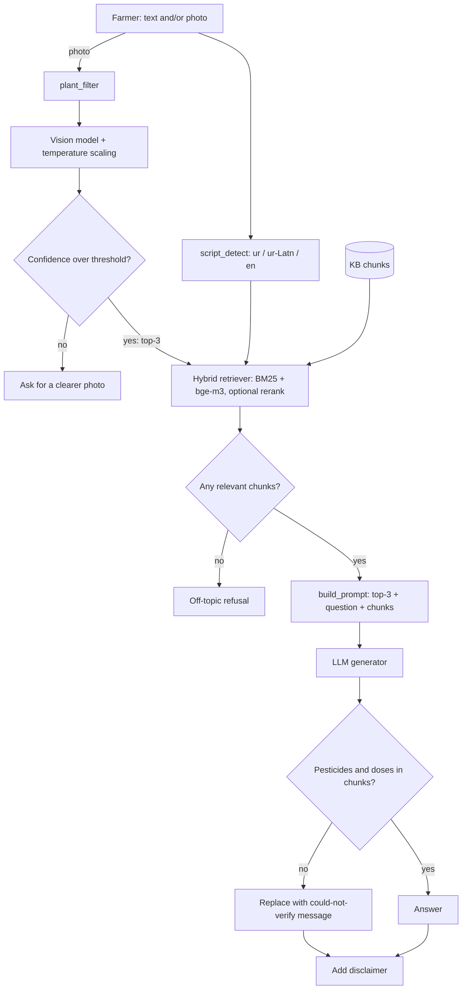
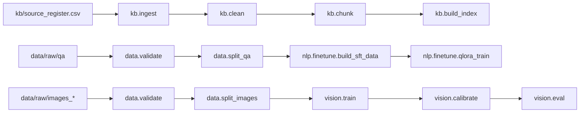

# Architecture

A farmer sends text, a photo, or both. `script_detect` picks the reply language. A photo goes through the plant filter and the calibrated classifier. If the classifier abstains, the system asks for a clearer photo instead of guessing. Otherwise its top-3 labels join the question for retrieval and prompting. The LLM answers from the retrieved chunks, and `safety` blocks any pesticide or dose not found in them and adds the extension-officer disclaimer.

## Offline flow

## Evaluation

Retrieval: `eval.retrieval_metrics`. Vision: `eval.vision_metrics`. Answers: blinded expert ratings in `eval/rating_sheets/`, aggregated by `eval.expert_ratings`. Usability: `eval.sus` on the pilot log.
