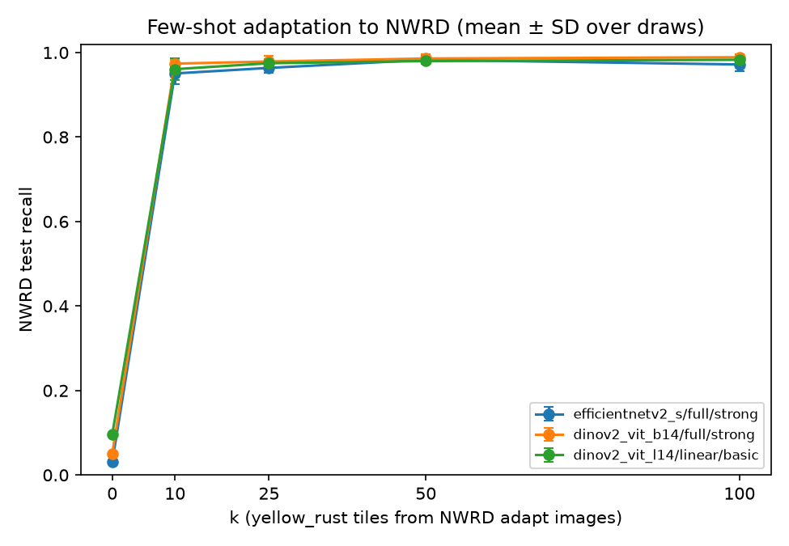

# wheat_v2 few-shot adaptation to NWRD

Can a few labelled field tiles fix stripe rust on NWRD, and what does it cost on healthy leaves?
Generated by `python -m zarai.vision.fewshot_nwrd` from the MLflow experiment
`wheat_v2_fewshot_nwrd` (`scripts/run_wheat_v2_fewshot.sh` runs everything). Only logged numbers;
[TBD] means not run. Don't edit between the markers.

<!-- results:start -->
NWRD split by image (seed 42): 211 adapt tiles, 198 test tiles. Healthy: 1117 pooled-train images to draw from, 241 pooled-test images for the false-positive rate. 60 steps per adaptation, batch min(32, 2k), learning rate 1e-05 (full) or 0.001 (linear), no early stopping. k = 0 is the pooled checkpoint unchanged; other k are mean ± SD over 5 draws.

*Recall*: NWRD test tiles predicted `yellow_rust`. *FPR yellow*: held-out healthy images predicted `yellow_rust`. *FPR any*: held-out healthy images predicted as any disease.

| model | k | draws | NWRD test recall | FPR yellow | FPR any |
| --- | --- | --- | --- | --- | --- |
| efficientnetv2_s/full/strong | 0 | 1/1 | 0.030 | 0.021 | 0.050 |
| efficientnetv2_s/full/strong | 10 | 5/5 | 0.951 ± 0.025 | 0.074 ± 0.025 | 0.080 ± 0.028 |
| efficientnetv2_s/full/strong | 25 | 5/5 | 0.964 ± 0.012 | 0.066 ± 0.025 | 0.072 ± 0.026 |
| efficientnetv2_s/full/strong | 50 | 5/5 | 0.983 ± 0.009 | 0.064 ± 0.022 | 0.070 ± 0.023 |
| efficientnetv2_s/full/strong | 100 | 5/5 | 0.972 ± 0.016 | 0.052 ± 0.015 | 0.057 ± 0.015 |
| dinov2_vit_b14/full/strong | 0 | 1/1 | 0.051 | 0.017 | 0.029 |
| dinov2_vit_b14/full/strong | 10 | 5/5 | 0.974 ± 0.009 | 0.028 ± 0.002 | 0.028 ± 0.002 |
| dinov2_vit_b14/full/strong | 25 | 5/5 | 0.979 ± 0.013 | 0.025 ± 0.004 | 0.025 ± 0.004 |
| dinov2_vit_b14/full/strong | 50 | 5/5 | 0.986 ± 0.011 | 0.024 ± 0.005 | 0.025 ± 0.005 |
| dinov2_vit_b14/full/strong | 100 | 5/5 | 0.989 ± 0.007 | 0.025 ± 0.003 | 0.025 ± 0.003 |
| dinov2_vit_l14/linear/basic | 0 | 1/1 | 0.096 | 0.012 | 0.033 |
| dinov2_vit_l14/linear/basic | 10 | 5/5 | 0.961 ± 0.026 | 0.049 ± 0.017 | 0.061 ± 0.019 |
| dinov2_vit_l14/linear/basic | 25 | 5/5 | 0.975 ± 0.010 | 0.041 ± 0.018 | 0.056 ± 0.018 |
| dinov2_vit_l14/linear/basic | 50 | 5/5 | 0.980 ± 0.004 | 0.032 ± 0.009 | 0.045 ± 0.011 |
| dinov2_vit_l14/linear/basic | 100 | 5/5 | 0.983 ± 0.010 | 0.019 ± 0.018 | 0.031 ± 0.022 |

<!-- results:end -->
